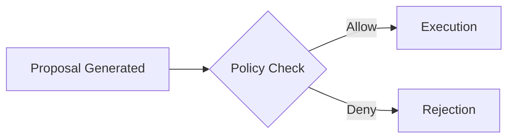

# Contributing to M31 Autonomous Documentation

Thank you for your interest in contributing to the **M31 Autonomous (M31A)** documentation platform! This guide outlines the conventions, validation workflows, and steps required to propose changes.

---

## 🧭 Philosophy & Tone

The documentation follows the core architectural principles of M31A:
- **Accuracy & Honesty**: All specifications must reflect the actual Rust runtime behavior. Never fabricate features or unsupported configurations.
- **Clarity & Precision**: Use direct, active voice. Explain the *why* alongside the *how*.
- **Axiomatic Consistency**: Remember the foundational axiom: *"The model proposes. The runtime decides."*

---

## 🛠️ Local Development Setup

1. **Clone the repository**:
   ```bash
   git clone https://github.com/eshanized/docs.m31a.tonmoyinfrastructure.org.git
   cd docs.m31a.tonmoyinfrastructure.org
   ```

2. **Install dependencies**:
   ```bash
   npm ci
   ```

3. **Start local preview**:
   ```bash
   npm start
   ```
   Open [http://localhost:3000](http://localhost:3000) in your browser.

---

## 📝 Document Conventions

### Frontmatter

Every documentation page in `docs/` must start with proper frontmatter metadata:

```markdown
---
id: doc-identifier
title: Concise Page Title
sidebar_label: Short Navigation Label
description: One to two sentences summarizing the page for search indexing and social cards.
---
```

### Headings
- Use a single `# Title` at the top (or let frontmatter handle it).
- Subsections should use `##`, `###`, etc. sequentially without skipping levels.

### Code Blocks
Always specify the syntax highlighter language:

````markdown
```rust
pub fn evaluate_policy(proposal: &Proposal) -> PolicyDecision {
    // ...
}
```
````

Supported languages include: `rust`, `bash`, `toml`, `json`, `yaml`, `sql`, `diff`, `markdown`.

### Mermaid Diagrams
Use fenced `mermaid` code blocks with quotes around complex labels to prevent syntax errors:

````markdown

````

### Admonitions / Callouts
Use standard Docusaurus callouts:

```markdown
:::note
Informative note or background context.
:::

:::tip
Optimization or developer workflow tip.
:::

:::warning
Critical requirement or operational caution.
:::
```

---

## 📂 Registering New Documents in Sidebars

When adding a new `.md` file to `docs/`:
1. Place it in the appropriate subsystem subfolder (e.g., `docs/subsystems/`).
2. Add its relative path (omitting the `.md` extension) into [`sidebars.ts`](./sidebars.ts):

```typescript
{
  type: 'doc',
  id: 'subsystems/my-new-subsystem',
  label: 'My New Subsystem',
}
```

---

## 🧪 Validation & Pre-Commit Checks

Before opening a pull request, run the automated validation suite:

```bash
# Full validation (type check + coverage check + link check + build test)
npm run validate

# Or run individual checks:
npm run typecheck
npm run validate:links
npm run validate:coverage
```

All checks must pass with exit code `0`.

---

## 🚀 Submitting a Pull Request

1. Create a feature branch:
   ```bash
   git checkout -b docs/your-topic-name
   ```
2. Commit your changes following conventional commits (e.g. `docs(security): update threat model notes`):
   ```bash
   git commit -m "docs: add guide for custom policy gates"
   ```
3. Push to your fork or branch:
   ```bash
   git push origin docs/your-topic-name
   ```
4. Open a Pull Request against the `master` branch on GitHub.
5. Fill out the PR template checklist to ensure all quality gates are satisfied.
