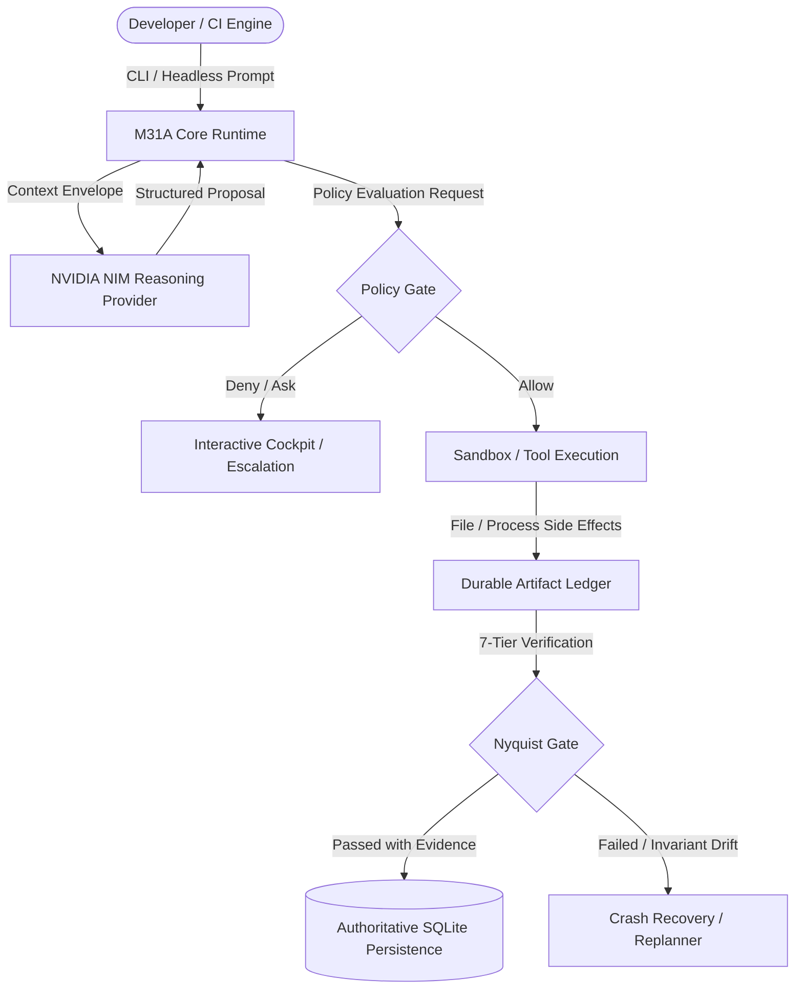
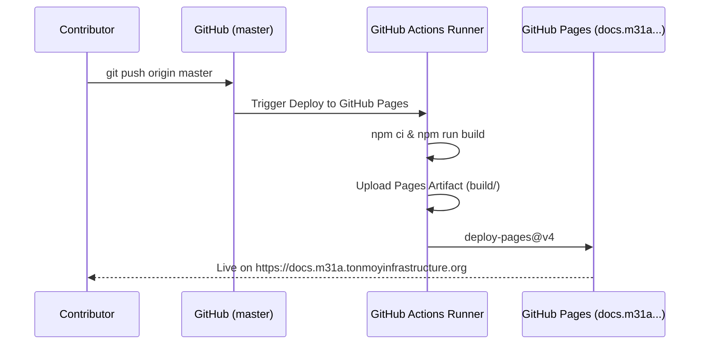

<div align="center">

# M31 Autonomous (M31A) Documentation Platform

[](https://github.com/eshanized/docs.m31a.tonmoyinfrastructure.org/actions/workflows/deploy.yml)
[](https://docs.m31a.tonmoyinfrastructure.org)
[](https://docusaurus.io/)
[](https://www.typescriptlang.org/)
[](https://github.com/eshanized/M31A)
[](./LICENSE)

<p align="center">
  <strong>The authoritative technical documentation platform and architectural reference for M31 Autonomous (M31A).</strong><br>
  Built with high-assurance engineering rigor, offline-first search, native Mermaid diagrams, and automated GitHub Pages deployment.
</p>

[**Explore Documentation**](https://docs.m31a.tonmoyinfrastructure.org) •
[**M31A Core Repository**](https://github.com/eshanized/M31A) •
[**Issue Tracker**](https://github.com/eshanized/docs.m31a.tonmoyinfrastructure.org/issues) •
[**Contributing**](./CONTRIBUTING.md)

</div>

---

## 🧭 Foundational Axiom

> *"The model proposes. The runtime decides."*

Unlike conventional LLM wrappers or generative coding assistants that allow an AI model to directly execute shell commands or overwrite files, **M31 Autonomous (M31A)** treats language models strictly as untrusted reasoning components. All model outputs are classified as *proposals*. The authoritative Rust runtime independently validates proposals, enforces security policies, schedules work via a DAG, supervises processes in sandboxes, and demands cryptographic evidence before verifying completion.



---

## ⚡ Platform Architecture & Features

This documentation platform is engineered to deliver fast, deterministic, and accessible reference material across desktop and mobile browsers:

- **Docusaurus 3.10 + React 18 + TypeScript 5**: Modern static site generation with complete type safety.
- **Offline Client-Side Search**: Zero external API dependencies; powered by `@easyops-cn/docusaurus-search-local` with indexed page headers and full-text search.
- **Native Mermaid Diagramming**: Integrated `@docusaurus/theme-mermaid` with `@mermaid-js/layout-elk` for responsive architectural sequence charts, state machines, and DAG visualizations.
- **Atmospheric Typography & Code Highlighting**: Styled with *Fira Sans* and *Fira Code* typography, alongside Prism syntax highlighters for Rust, SQL, Bash, TOML, JSON, and YAML.
- **Automated CI/CD Deployment**: GitHub Actions workflow builds the site on every push to `master` and publishes directly to GitHub Pages with custom domain routing.
- **Automated Validation Suite**: Includes Python-based scripts to verify document coverage and link integrity before any production build.

---

## 📚 Documentation Catalog

The documentation is organized into 12 structured subsystem sections:

```
docs/
├── intro/                 # High-level overview, foundational axioms, and core distinctions
├── getting-started/       # Installation, toolchain setup, and five-minute quickstart
├── user-guide/            # CLI commands, interactive cockpit, headless CI, prompting patterns
├── architecture/          # Runtime architecture, DAG scheduler, policy gates, and verification tiers
├── subsystems/            # Deep dives into SQLite persistence, NVIDIA NIM integration, sandbox isolation
├── codebase/              # Source code map, dependency analysis, and complete SBOM
├── reference/             # CLI flags, exit code taxonomy (0–7), configuration schema, error registry
├── security/              # Threat model, prompt injection defense, credential isolation
├── deployment/            # Production (m31a) vs Development (m31a-dev) channels, systemd supervision
├── tests/                 # 7-tier verification catalog, invariant tests, and coverage matrix
├── troubleshooting/       # Failure signatures, diagnostic triage, crash recovery workflows
└── developer/             # Developer environment setup, tooling standards, and workflow guide
```

---

## 🚀 Getting Started (Local Development)

### Prerequisites

- [Node.js](https://nodejs.org/) `>= 20.0.0`
- [npm](https://www.npmjs.com/) `>= 10.0.0`
- [Python](https://www.python.org/) `>= 3.10` (for validation scripts)

### Installation

Clone the repository and install dependencies with a clean install:

```bash
git clone https://github.com/eshanized/docs.m31a.tonmoyinfrastructure.org.git
cd docs.m31a.tonmoyinfrastructure.org
npm ci
```

### Local Development Server

Start a live-reloading development server on `http://localhost:3000`:

```bash
npm start
```

### Validation & Quality Assurance

Run the comprehensive validation suite (type checking, link checking, coverage checks, and production build):

```bash
# Run full validation pipeline
npm run validate

# Run individual checks
npm run typecheck            # TypeScript compiler check without emitting files
npm run validate:coverage    # Verify documentation coverage against source map
npm run validate:links       # Verify internal Markdown links and anchor validity
```

### Production Build & Preview

Compile static production assets into `./build` and test locally:

```bash
# Generate optimized production build
npm run build

# Serve the production build locally
npm run serve
```

---

## 🚢 CI/CD & Deployment

This repository uses modern GitHub Pages deployment powered by GitHub Actions:

- **Workflow File**: [`.github/workflows/deploy.yml`](./.github/workflows/deploy.yml)
- **Deployment Trigger**: Automatically triggered on any push or merge to the `master` branch (or via manual `workflow_dispatch`).
- **Target URL**: [https://docs.m31a.tonmoyinfrastructure.org](https://docs.m31a.tonmoyinfrastructure.org)
- **Custom Domain CNAME**: Tracked in [`static/CNAME`](./static/CNAME) to ensure domain routing persistence.



---

## 🤝 Contributing

Contributions to the M31A documentation are warmly welcomed! Please read our [**Contributing Guide**](./CONTRIBUTING.md) for details on:
- Formatting standards and frontmatter requirements.
- Writing style and tone guidelines.
- How to add new pages and register them in [`sidebars.ts`](./sidebars.ts).
- Verifying changes with `npm run validate` before submitting a Pull Request.

---

## 📄 License

This documentation platform is distributed under the **MIT License**. See [`LICENSE`](./LICENSE) for details.
