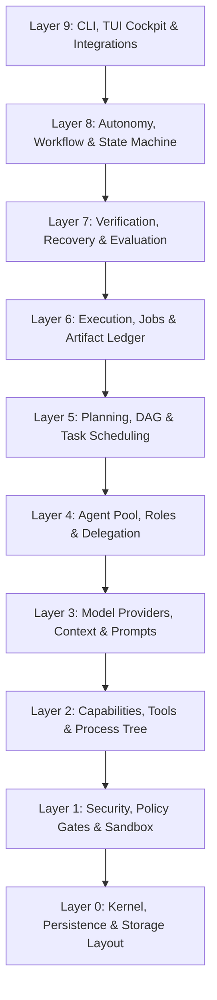

# M31A System Architecture (L0-L9)

M31A is organized into 10 strict downward-dependent architectural layers.

## Layer Summary

| Layer | Primary Subsystems | Core Responsibilities |
|---|---|---|
| **L0 Kernel & Storage** | `kernel`, `persistence`, `storage`, `events`, `ids` | Strongly typed UUID v7 domain IDs, SQLite database pool, storage layout, cancellation tokens |
| **L1 Security & Policy** | `policy`, `sandbox`, `platform`, `config` | Non-bypassable policy evaluation, 8-tier configuration engine, Landlock/seccomp confinement |
| **L2 Capabilities & Tools** | `capability`, `tools`, `process`, `git`, `repo` | 28 core model tools, process tree supervision, Git worktrees, LSP code intelligence |
| **L3 Intelligence & Context**| `model`, `prompt`, `context`, `memory` | NVIDIA NIM provider, SSE streaming accumulator, context token compaction, prompt templates |
| **L4 Agents & Roles** | `agent`, `skill` | 18 built-in agent roles, supervisor, adaptive replanning, multi-agent task delegation |
| **L5 Planning & Scheduling**| `planning`, `dag`, `scheduler` | Task graph decomposition, Critical Path Method (CPM), topological sorting, job worker pool |
| **L6 Execution & Checkpoints**| `change`, `checkpoint`, `pipeline` | Two-phase checkpoint manager, artifact ledger, workspace change application |
| **L7 Verification & Recovery**| `verification`, `eval`, `recovery` | 7-tier verification hierarchy, Nyquist gate, crash recovery scanner, acceptance eval |
| **L8 Autonomy & Workflows** | `controller`, `state`, `workflow`, `telemetry` | Autonomy controller, stage progression, Genesis multi-stage workflows, metrics collection |
| **L9 CLI, TUI & Deployment**| `cli`, `tui`, `init`, `interaction`, `deployment` | Clap 4 CLI, Ratatui cockpit, setup wizard, compile-time deployment channel isolation |
