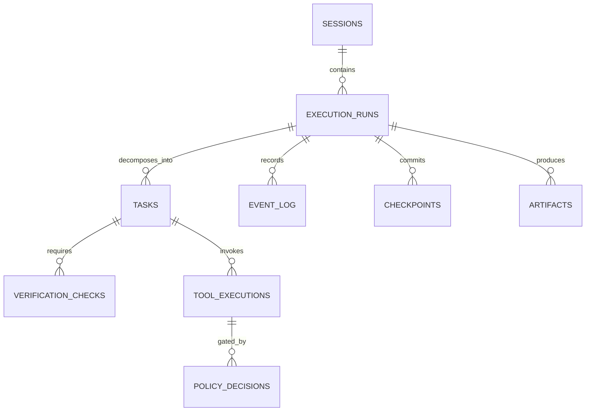

# Persistence Design & Relational Schema

M31A uses an embedded SQLite database configured with Write-Ahead Logging (WAL) and foreign keys enabled.

## Canonical Relational Entity Relationships

## Migration Infrastructure

Migrations reside in `migrations/` and are managed via SQLx:
- `001_initial.sql` to `012_interactive_sessions.sql`: Core schema (tasks, events, checkpoints, sessions).
- `013_workflow_orchestration.sql` to `028_model_invocation_cost.sql`: Advanced workflows, prompt refs, and telemetry.
- `029_remove_budget_system.sql`: Decommissioned token budget ledger.
- `030_replace_mission_with_execution_run.sql` to `032_canonical_execution_run_consolidation.sql`: Replaced legacy missions with canonical `execution_runs`.
