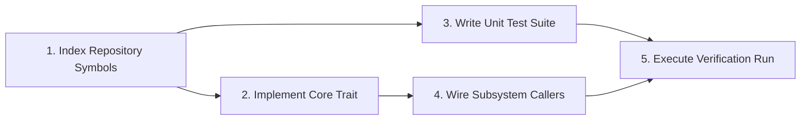

# Planning DAG & Critical Path Scheduling

M31A models autonomous software engineering as a dependency-aware Directed Acyclic Graph (DAG) of discrete tasks.

## DAG Representation & Critical Path Method

Located in `src/dag/`:
- **Nodes**: `Task` entities with explicit inputs, outputs, required capabilities, and verification strategies.
- **Edges**: Dependency relationships (`depends_on`).
- **Critical Path Method (`cpm.rs`)**: Calculates earliest start times, latest completion times, and identifies bottleneck tasks along the critical path to optimize parallel execution.

## Cycle Detection & Validation

Before materializing a DAG into SQLite, `src/dag/validator.rs` validates:
1. **Acyclicity**: Tarjan's strongly connected components algorithm ensures no cyclic deadlocks exist.
2. **Capability Satisfaction**: Verifies that required capabilities (e.g. `fs.write`, `process.exec`) are permitted under the active policy.
3. **Verification Feasibility**: Confirms that every mutating task specifies an executable verification strategy.
