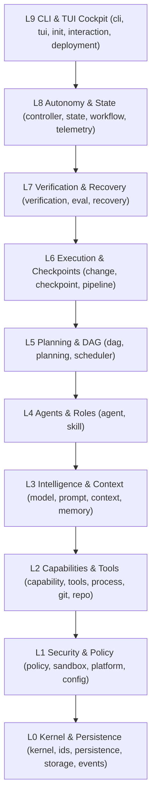

# M31A Codebase Reference

> **Authoritative Implementation Index:** 567 first-party Rust source files across 42 functional subsystems.

This section provides an exhaustive, verified reference for the entire M31A application codebase located at `/home/snigdha/Desktop/M31A/src/`.
Every module, struct, enum, trait, and function documented here corresponds to tested code in revision `3eddbfd3`.

## Subsystem Navigation Matrix

| Subsystem | Layer | Files | Description | Reference Link |
|---|---|:---:|---|---|
| **Agent Subsystem** | L4 Agents | 17 | Agent roles, lifecycle, supervisor, runner, adaptive replanning, and delegation | [Inspect Modules](/docs/codebase/agent) |
| **Capability Registry & Providers** | L2 Capabilities | 38 | Typed capabilities, health monitoring, provider implementations (fs, git, lsp, terminal, web, etc.) | [Inspect Modules](/docs/codebase/capability) |
| **Change Management** | L6 Execution | 7 | Workspace change application, review, provenance, authority, and reconciliation | [Inspect Modules](/docs/codebase/change) |
| **Checkpoint & Crash Recovery** | L6/L7 Checkpoints | 6 | Two-phase durable checkpoint protocol, manifest hashing, crash recovery scanner, and safe resume | [Inspect Modules](/docs/codebase/checkpoint) |
| **CLI & Dispatch Layer** | L9 CLI / Interface | 6 | Clap 4 argument hierarchy, output formatters, exit codes, and runtime command dispatch | [Inspect Modules](/docs/codebase/cli) |
| **Configuration Engine** | L1 Configuration | 11 | 8-tier hierarchical configuration precedence, strict schema validation, canonical defaults, and provenance | [Inspect Modules](/docs/codebase/config) |
| **Context Compiler & Tokenizer** | L3 Intelligence | 8 | Token budgeting, prompt envelope assembly, evidence ranking, and context window compaction | [Inspect Modules](/docs/codebase/context) |
| **Autonomy Controller** | L8 Autonomy | 8 | Execution stage transitions, halting criteria, loop detection, and progress monitoring | [Inspect Modules](/docs/codebase/controller) |
| **DAG & Critical Path Method** | L5 Planning | 7 | Directed acyclic task graphs, topological sorting, critical path analysis, and reconciliation | [Inspect Modules](/docs/codebase/dag) |
| **Deployment & Channels** | L9 Deployment | 11 | Compile-time channel isolation (production vs development), update feeds, installer, and rollback | [Inspect Modules](/docs/codebase/deployment) |
| **Autonomous Evaluation Harness** | L7 Verification | 13 | Acceptance test scenarios A through H, scoring, and automated evaluation runner | [Inspect Modules](/docs/codebase/eval) |
| **Event Bus & Envelopes** | L0/L8 Event Bus | 4 | Broadcast channels, structured telemetry envelopes, and asynchronous event distribution | [Inspect Modules](/docs/codebase/events) |
| **Git & Worktree Isolation** | L2 Git Operations | 10 | Worktree management, branch naming, isolated attribution, trailers, stash, and hosting | [Inspect Modules](/docs/codebase/git) |
| **Domain Identity Types** | L0 Domain Identities | 18 | Strongly typed domain IDs (ExecutionRunId, TaskId, AgentId, ArtifactId, CheckId, etc.) | [Inspect Modules](/docs/codebase/ids) |
| **Initialization & Doctor** | L9 Initialization | 4 | Workspace setup wizard, environment diagnostic probes, and lifecycle bootstrapping | [Inspect Modules](/docs/codebase/init) |
| **Interaction & Slash Commands** | L9 Interaction | 13 | Session parser, user-defined slash commands, approval actions, and mention resolution | [Inspect Modules](/docs/codebase/interaction) |
| **Kernel Core & Seams** | L0 Kernel | 16 | Core seams, architectural invariants, cancellation tokens, hashes, and memory boundaries | [Inspect Modules](/docs/codebase/kernel) |
| **Engineering Memory** | L3 Intelligence | 6 | Persistent engineering decisions, architectural assumptions, and historical project memory | [Inspect Modules](/docs/codebase/memory) |
| **Model & Provider Layer** | L3 Intelligence | 16 | NVIDIA NIM provider, SSE streaming, model catalog, dynamic discovery, and token usage | [Inspect Modules](/docs/codebase/model) |
| **Persistence & SQLite** | L0 Persistence | 26 | SQLite database pool, schema migrations 001-032, repositories, and artifact store | [Inspect Modules](/docs/codebase/persistence) |
| **Pipeline Execution** | L5/L6 Pipeline | 18 | End-to-end task pipelines, staging, execution harnesses, and lifecycle transitions | [Inspect Modules](/docs/codebase/pipeline) |
| **Planning & Decomposition** | L5 Planning | 15 | Mission decomposition, strategy generation, plan revision, and candidate DAG creation | [Inspect Modules](/docs/codebase/planning) |
| **Platform Abstractions** | L1 Platform | 17 | Cross-platform OS primitives (Linux, macOS, Windows), process control, and path handling | [Inspect Modules](/docs/codebase/platform) |
| **Policy Engine & Security Gates** | L1 Security | 15 | Non-bypassable policy evaluation, 4 decisions (Allow/Deny/Ask/Escalate), and approvals | [Inspect Modules](/docs/codebase/policy) |
| **Process Supervision** | L2 Process | 11 | Process tree supervisor, PID tracking, spool capture, signal escalation, and timeouts | [Inspect Modules](/docs/codebase/process) |
| **Prompt System** | L3 Intelligence | 16 | Prompt registry, template rendering, versioning, and prompt references | [Inspect Modules](/docs/codebase/prompt) |
| **Recovery & Replanning** | L7 Recovery | 5 | Differential replanning, failure diagnosis, and automated remediation | [Inspect Modules](/docs/codebase/recovery) |
| **Release Certification** | L9 Release | 8 | Release manifests, 20-point production evidence matrix, and release certification | [Inspect Modules](/docs/codebase/release) |
| **Repository Intelligence** | L2 Repository | 13 | Code search, symbol extraction, dependency graph, and workspace drift detection | [Inspect Modules](/docs/codebase/repo) |
| **Execution Reports** | L8 Reporting | 6 | Structured scorecard generation, telemetry summaries, and execution reports | [Inspect Modules](/docs/codebase/report) |
| **Root Application & Runtime** | L0-L9 Composition | 6 | main.rs, lib.rs, error taxonomy, and authoritative AppRuntime composition root | [Inspect Modules](/docs/codebase/root) |
| **Sandbox & Confinement** | L1 Sandbox | 13 | Filesystem sandboxing, network destination policies, and resource confinement | [Inspect Modules](/docs/codebase/sandbox) |
| **Scheduler & Job Admission** | L5 Scheduling | 10 | Global job worker pool, concurrency limits, and task scheduling | [Inspect Modules](/docs/codebase/scheduler) |
| **Skill System** | L2 Skills | 6 | Modular skill discovery, invocation, and in-task execution guidance | [Inspect Modules](/docs/codebase/skill) |
| **Authoritative State Management** | L8 State | 15 | Execution run state, session state, task state, and SQLite projection | [Inspect Modules](/docs/codebase/state) |
| **Domain State Machines** | L8 State Machine | 9 | Strict state transition matrices for missions, tasks, agents, and autonomy modes | [Inspect Modules](/docs/codebase/state_machine) |
| **Storage Layout** | L0 Storage | 2 | Platform storage layout, global vs workspace state isolation, and legacy migrations | [Inspect Modules](/docs/codebase/storage) |
| **Telemetry & Spans** | L8 Telemetry | 7 | Distributed tracing spans, metrics recording, and operational observability | [Inspect Modules](/docs/codebase/telemetry) |
| **Model Tools & Catalog** | L2 Tools | 18 | Central catalog of 28 core tools and extended tools (fs, git, qa, repo, web, etc.) | [Inspect Modules](/docs/codebase/tools) |
| **Ratatui TUI Cockpit** | L9 TUI Cockpit | 62 | 62-file terminal cockpit, read-only projection over SQLite, streaming, and screens | [Inspect Modules](/docs/codebase/tui) |
| **Verification & Nyquist Gate** | L7 Verification | 15 | 7-tier verification hierarchy, evidence snapshot matching, and completion gate | [Inspect Modules](/docs/codebase/verification) |
| **Genesis & Engineering Workflows** | L8 Workflow | 35 | 35-file multi-stage genesis workflows, ADR creation, charter, synthesis, and roadmap | [Inspect Modules](/docs/codebase/workflow) |

**Total Source Footprint:** 567 Rust source files, approximately 230,961 lines of code.

## Architectural Layers Summary

### Architectural Law: Downward Dependency Discipline
Dependencies flow downward only. A lower layer (e.g., L1 Security) may never import or depend on a higher layer (e.g., L8 Autonomy or L9 CLI).
All model proposals pass downward through L5 (DAG), L1 (Policy Gate), before reaching L2 (Side-effect tools) or L0 (Persistence).