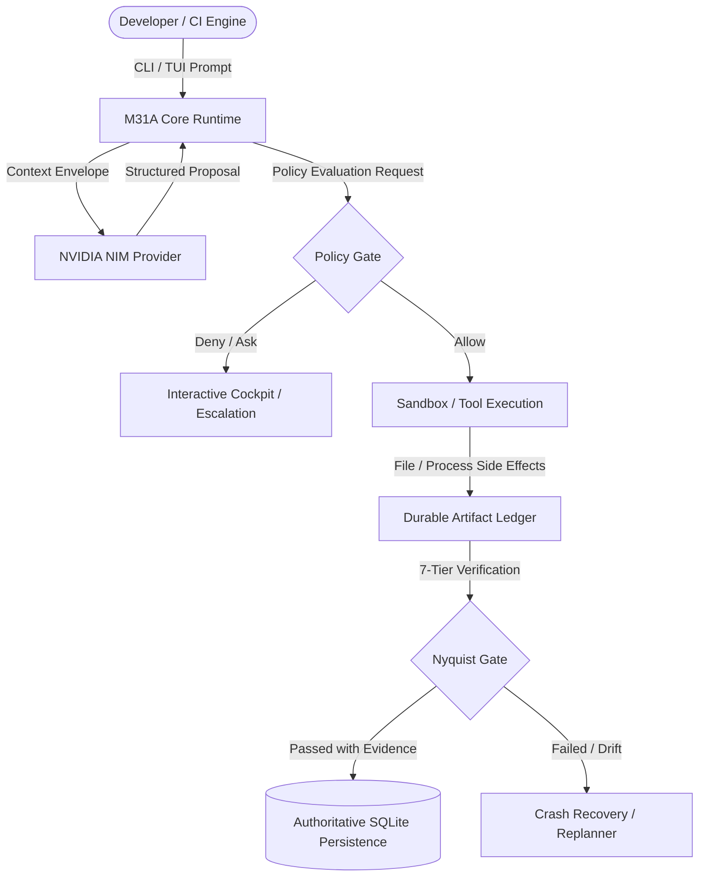

# M31 Autonomous (M31A) Overview

**M31 Autonomous (M31A)** is a single-crate, Rust-native autonomous software engineering runtime engineered for deterministic execution, non-bypassable security policy gates, verifiable code mutation, and isolated Git attribution.

> **Foundational Axiom:** *"The model proposes. The runtime decides."*

Unlike conventional LLM wrappers or generative coding assistants that allow an AI model to directly execute shell commands, overwrite files, or mark tasks complete, M31A treats language models strictly as untrusted reasoning components. All model outputs are classified as *proposals*. The authoritative Rust runtime independently validates proposals, enforces security policies, schedules work via a DAG, supervises processes in sandboxes, and demands cryptographic evidence before verifying completion.

## Core Distinctions

1. **Rust-Native Performance & Reliability**: Pure Rust core with zero Python, Node.js, or GPU runtime dependencies. Single static binary deployment.
2. **ExecutionRun Authority**: Replaced legacy mission entities with canonical `ExecutionRun` records (database migrations 030-032). All session, task, event, and artifact states derive from authoritative execution runs.
3. **NVIDIA NIM Production Exclusivity**: Production reasoning is powered exclusively via NVIDIA NIM (`integrate.api.nvidia.com/v1`), supporting advanced models such as `meta/llama-3.2-11b-vision-instruct`. Legacy providers (OpenAI, Anthropic, Gemini, Ollama) are deterministically rejected with clear diagnostics.
4. **Non-Bypassable Layer 1 Policy Gate**: Every tool execution passes through the security gate. Decisions are classified into 4 deterministic states: `Allow`, `Deny`, `Ask`, and `Escalate`.
5. **7-Tier Gated Verification Hierarchy**: Multi-stage fail-fast verification (Deterministic → Compiler → Tests → Static Analysis → Invariants → Reviewer → Diagnostician). No task can complete on model self-report.
6. **Compile-Time Channel Isolation**: Mutually exclusive `production` (default `m31a`) and `development` (`m31a-dev`) channels prevent cross-contamination of persistent state.

## Target Audiences

- **Developers**: Automate repository maintenance, large-scale refactoring, unit test generation, and pull request workflows.
- **Architects & Researchers**: Explore high-assurance agent architectures, topological DAG scheduling, and formal verification gating.
- **Security Engineers**: Inspect audit ledgers, process sandboxing, credential boundaries, and prompt-injection defense walls.
- **DevOps & Release Engineers**: Run headless deterministic execution runs in CI pipelines with exit codes 0 through 7.
