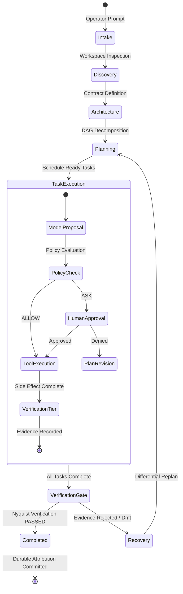

# Autonomous Execution Lifecycle

Every execution run in M31A transitions through a deterministic state machine managed by `src/controller/` and `src/state_machine/`.

## 1. Intake & Discovery
The operator's prompt is parsed into an authoritative `ExecutionRun` record with a unique UUID v7. The runtime discovers workspace baselines, Git HEAD, and configuration profiles.

## 2. Planning & DAG Decomposition
The `planner` agent breaks down the high-level objective into discrete, typed tasks forming a Directed Acyclic Graph (DAG). Dependencies and critical paths are resolved using the Critical Path Method (CPM).

## 3. Gated Execution
Tasks with satisfied dependencies are dispatched to worker agents (`implementer`, `researcher`, `verifier`). Each tool call passes through the non-bypassable Policy Gate.

## 4. 7-Tier Verification Gate
Upon task completion, the runtime executes the 7-tier verification hierarchy. The task is only marked `Succeeded` if all required checks pass with cryptographic evidence.

## 5. Isolated Attribution & Git Commit
When the execution run completes, changes are staged, trailers (including `M31A-Execution-Run`, `M31A-Agent-Role`, `M31A-Verification-Id`) are generated, and a clean Git commit is recorded.
